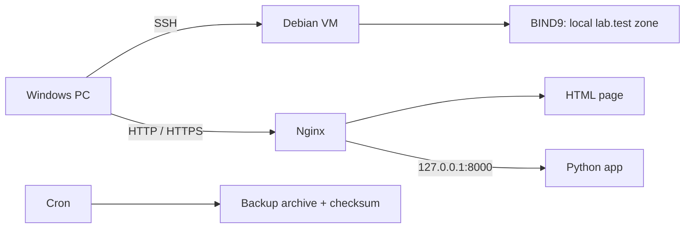

# My Debian web server lab

I started this project to practice Linux server administration and have something working to show in my portfolio. I installed Debian in VMware on my Windows PC, then set up a web server with a small Python backend.

The VM runs Debian 13. The VMware template said Debian 12, so checking `/etc/os-release` was one of the first things I had to sort out.

This repository contains the configs, setup scripts, test output and screenshots. The server itself runs in my local VM.

## What I built

- Nginx serves an HTML page and redirects HTTP to HTTPS.
- `/api/health` goes through Nginx to a Python app on `127.0.0.1:8000`.
- The app runs as its own user through systemd.
- UFW allows incoming TCP traffic on 22, 80 and 443.
- BIND9 serves a local `lab.test` zone, only inside the VM.
- SSH uses a separate login key, with root login disabled.
- fail2ban is configured for SSH.
- A backup script saves the configs, app and page, with a checksum. Cron runs it daily at 02:15 in the VM's timezone.

## Problems I ran into

My user wasn't in the sudo group, and SSH wasn't active at first. After fixing those, I checked that I could connect from Windows.

Copy and paste into VMware didn't work reliably. Using SSH made it possible to continue the setup without typing every command into the VM window.

I originally planned to use `lab.local` for DNS. I used `lab.test` instead because `.local` is used by multicast DNS. Keeping DNS on loopback also let me keep the firewall limited to the three ports above.

HTTPS needed a little extra work because the certificate is self-signed. The tests use the lab certificate and the hostname `web.lab.test` to check it properly.

## Checks that passed

The services were running and enabled, and the Nginx, SSH and BIND config checks passed. From Windows, ports 22, 80 and 443 were reachable; DNS and the Python port were not.

The HTTPS page loaded, and `/api/health` returned HTTP 200 with `status: ok`. DNS queries worked over UDP and TCP inside Debian.

The backup checksum passed. Extracting the archive into a temporary directory and comparing selected files also passed. A temporary cron job confirmed that cron could run the backup script.

For fail2ban, the test was a manual ban and unban of `192.0.2.123`, a documentation address. I haven't tested detection with repeated failed logins yet.

[Server checks](docs/server-verification.txt) · [Checks from Windows](docs/host-verification.txt) · [Screenshots](docs/SCREENSHOTS.md)

## Files

| Folder | Contents |
| --- | --- |
| `configs/` | Copies of the server configuration |
| `app/` | The Python health API |
| `site/` | The HTML page |
| `scripts/` | Setup, verification and backup scripts |
| `docs/` | Command output, screenshots and my maintenance notes |

[Maintenance commands](docs/OPERATIONS.md)

`scripts/provision.sh` is for a fresh, dedicated lab VM. It replaces some default configs, so I wouldn't run it on an existing server without reviewing it first.

## What I still want to improve

I still need to check the services after a reboot and observe a normal overnight backup. The backup script also needs a retention policy and a copy stored outside the VM.

The Python app is a small learning example, and HTTPS uses a local certificate. A public deployment would need different hosting and a real domain certificate. I haven't hosted a separate portfolio website yet.

There are six screenshots. Two show live server responses; four show saved command output in a browser viewer because capturing the VMware terminal wasn't working.

Passwords, private keys and backup archives stay outside this repository. The account password has been changed, and the old SSH login key has been replaced. Password login over SSH is still enabled.

## Docs I used

- [Nginx beginner guide](https://nginx.org/en/docs/beginners_guide.html)
- [Nginx HTTPS configuration](https://nginx.org/en/docs/http/configuring_https_servers.html)
- [Debian handbook: monitoring and fail2ban](https://www.debian.org/doc/manuals/debian-handbook/sect.supervision.en.html)
- [Reserved testing domains](https://www.rfc-editor.org/rfc/rfc2606)

