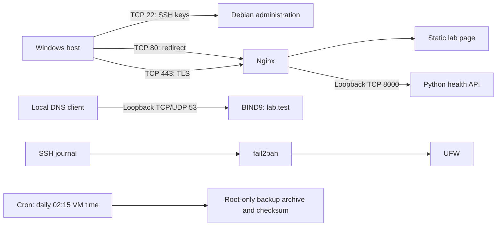

# Debian Web Server Lab

A documented Debian 13 web server built in VMware: Nginx serves a static page over HTTPS and proxies a Python health API. UFW limits inbound TCP access to SSH, HTTP and HTTPS. BIND9 provides a loopback-only authoritative lab zone; fail2ban protects SSH; cron schedules configuration and application backups.

**Status:** deployed and tested on 11 October 2026. Six browser screenshots are included. This is a private lab, not a publicly hosted production server. Source code and documentation are prepared for public portfolio publication.

## Architecture

## Verified results

| Check | Observed result |
|---|---|
| Debian packages | No pending upgrades during provisioning |
| SSH | Dedicated key login succeeded; normal user belongs to sudo group |
| Services | SSH, Nginx, named, lab-app, fail2ban and cron active and enabled |
| Config syntax | Nginx, sshd, BIND configuration and lab zone passed validation |
| External connectivity | TCP 22, 80 and 443 reachable from Windows; TCP 53 and 8000 unreachable |
| HTTP | 301 redirect to `https://web.lab.test/` |
| HTTPS | TLS 1.3 from Windows, chain and hostname verified using the lab certificate |
| Static content | Page title returned through HTTPS |
| Reverse proxy | `/api/health` returned HTTP 200 and JSON status `ok` |
| DNS | `web.lab.test` resolved to `127.0.0.1` over UDP and TCP from Debian |
| fail2ban | SSH jail active; controlled manual ban/unban created and removed a UFW rule |
| Backup | Archive checksum passed; extracted page, app and configs matched source files |
| Cron execution | A bounded one-shot cron test created a backup and passed its checksum; temporary test schedule removed |
| Logs | Backend requests recorded; Nginx error log was empty at verification |

Full evidence: [server verification](docs/server-verification.txt), [Windows host verification](docs/host-verification.txt), and [six screenshots with captions](docs/SCREENSHOTS.md).

The fail2ban action was tested with the documentation-only address `192.0.2.123`. Actual brute-force detection was not simulated. Cron execution passed a one-shot test; a regular overnight run has not yet been observed. The daily schedule is 02:15 in the VM's America/Chicago timezone. Restore testing compares selected files in a temporary directory, rather than restoring an entire VM.

Security review restricted custom Nginx logs to mode 0640 and disabled unneeded SSH compression, forwarding and X11 access. Fresh key login and HTTPS health checks passed afterward. Password authentication remains enabled pending the owner's decision. This demonstration is not certified vulnerability-free, and available Debian updates do not imply the absence of known package issues.

## Repository contents

- `configs/`: copies of deployed Nginx, DNS, SSH, fail2ban, systemd and cron configuration.
- `app/app.py`: Python API, bound exclusively to loopback.
- `site/index.html`: page served by the lab server.
- `scripts/provision.sh`: lab provisioning script; review before running on another machine.
- `scripts/verify.sh`: service and functional checks, including backup restore and a controlled fail2ban action.
- `docs/`: test evidence, operations guide, troubleshooting and screenshot plan.

## Design decisions

DNS uses `lab.test`, a reserved testing namespace, rather than `.local`, which can conflict with multicast DNS. BIND listens on loopback only: a DNS service accessible from other machines would require additional firewall rules for TCP/UDP 53. The Python API is a small lab demonstration using the standard library, not a production application server. It runs under a dedicated account with systemd restrictions.

TLS uses a self-signed certificate with SANs for `web.lab.test` and `lab.test`. It must be explicitly trusted for local tests; no public certificate was issued. A real-domain deployment would require valid DNS, appropriate hosting and a public certificate such as Let's Encrypt.

Backups contain private server keys and are retained only in root-protected VM storage. They are not committed to Git. A production design also needs encrypted off-machine backups and a retention policy.

## Problems solved

1. **VM label did not match the OS:** inspected `/etc/os-release`, confirming Debian 13 instead of relying on the Debian 12 VMware name.
2. **Normal user lacked sudo:** added the user to the sudo group, then reloaded the login session.
3. **SSH initially inactive:** enabled the SSH service and verified connectivity from Windows.
4. **Clipboard sharing blocked setup:** used a separate SSH connection and installed a dedicated public key.
5. **Host SSH client compatibility and key access:** used a dedicated Python SSH client, pinned the first-contact VM host key and verified subsequent key authentication. First-contact trust was TOFU, not independently verified.
6. **Strict three-port firewall versus DNS:** kept authoritative lab DNS on loopback instead of exposing port 53.
7. **Self-signed TLS testing:** used the lab certificate as an explicit trust anchor and the correct server hostname, without disabling certificate validation.

## Remaining work before portfolio publication

- Optionally replace the four browser evidence-viewer screenshots with native terminal captures when VMware capture works.
- Confirm a scheduled cron run and test service persistence after a controlled reboot.
- Confirm Windows hostname resolution/browser trust if direct browser access is wanted.
- The account password was changed locally; password SSH remains enabled and root SSH is disabled.
- Publish to a chosen GitHub account and host the portfolio on GitHub Pages or Cloudflare Pages.

## References

- [Nginx beginner guide](https://nginx.org/en/docs/beginners_guide.html)
- [Nginx HTTPS configuration](https://nginx.org/en/docs/http/configuring_https_servers.html)
- [Debian fail2ban guidance](https://www.debian.org/doc/manuals/debian-handbook/sect.supervision.en.html)
- [Reserved test names: RFC 2606](https://www.rfc-editor.org/rfc/rfc2606)

No passwords, SSH private keys, TLS private keys, backup archives or real public IP addresses are included in this project folder.

SSH access key rotation is verified in [the rotation record](docs/ssh-key-rotation.txt). Private access keys are kept outside this repository.
