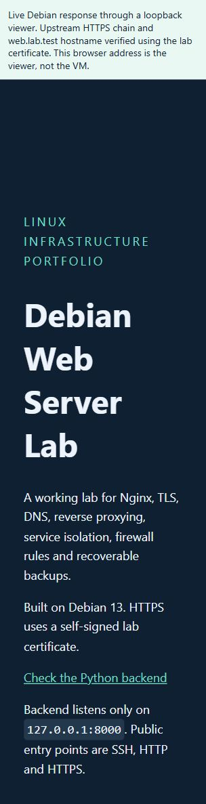
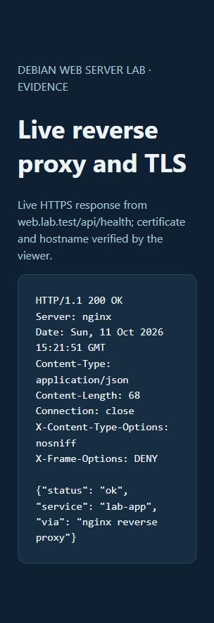
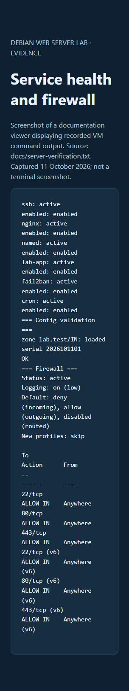
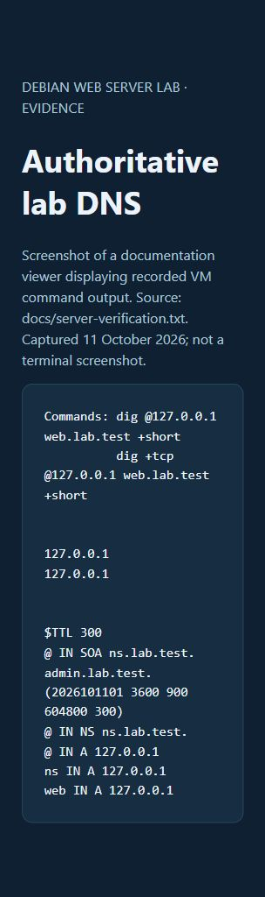
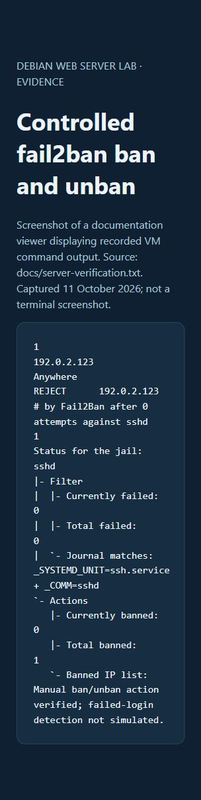
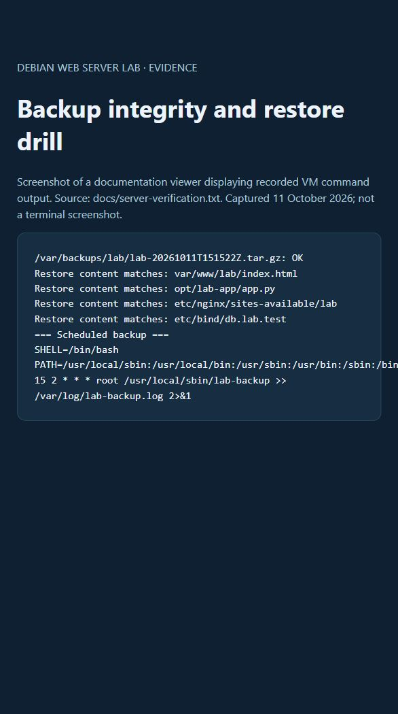

# Screenshots

Captured on 11 October 2026. The first two show live responses from the VM through a local browser viewer. That viewer checks the HTTPS certificate and hostname. The other four show saved command output; they are not terminal screenshots. The full output is in server-verification.txt.

## 1. Live Nginx page

Live static HTML returned by Debian over verified upstream HTTPS.

## 2. Live reverse proxy response

Live HTTP 200 and JSON from /api/health over verified upstream HTTPS.

## 3. Services and firewall

Recorded output: services active/enabled, config checks passed, inbound TCP rules for 22/80/443.

## 4. Authoritative DNS

Recorded UDP/TCP query output and deployed zone. DNS is loopback-only.

## 5. Controlled fail2ban action

Recorded manual ban/unban of documentation-only address 192.0.2.123; automatic failed-login detection was not simulated.

## 6. Backup and restore drill

Recorded checksum and comparison of extracted files. Cron is installed; no overnight execution is claimed.
